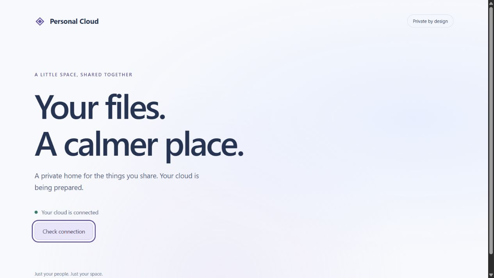
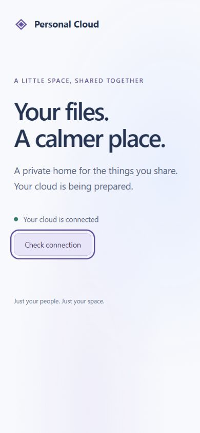
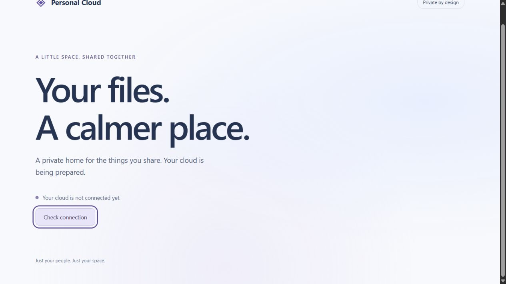

# Stage 2 local acceptance — 2026-10-21

**Stage 2 complete locally.** All foundation checklist/test gates passed. Stage 3 identity implementation, cloud provisioning, main merge and production deployment remain unapproved. This is a welcome shell and working local service foundation, not usable shared storage yet.

## Environment and reproducible verification

Owner installed WSL and restarted Windows. Verified WSL 3.0.3.0/default 2; the checksum/signature-verified Docker Desktop 4.95.0 per-user installer returned exit 0. Docker 29.8.2 Linux x86_64 engine and Compose v5.6.0 are running on the local `desktop-linux` named-pipe endpoint. Official hello-world download/execution passed.

`scripts/verify_compose.py` refuses remote Docker endpoints and occupied test ports, creates its own new project, and retains private command evidence under ignored `.local/compose-verification`. Run with the local Docker CLI on PATH and initialized development `.env`:

```powershell
.venv/Scripts/python.exe scripts/verify_compose.py
```

The successful project is `cloud-stage2-bf538a24b788`; all automated acceptance steps returned success. Evidence: `.local/compose-verification/bf538a24b788`; successful result metadata: `.cache/compose-latest.json`. It remains running for local review at `http://127.0.0.1:8080`. It contains only disposable markers, no real uploads/accounts. To free its ports, select this exact project and run Compose `down` without `-v`; keep its named volumes. The first unsuccessful project's containers/network were removed with exact local context/file/project selection and its named volumes preserved.

## Actual results

| Check | Result |
| --- | --- |
| Exact official PostgreSQL/Python/Node/Caddy manifests | All available; each advertises Linux amd64 and ARM64. Local execution was amd64, not an ARM64 deployment test. |
| Clean images/build/start | Passed locked/hash-checked runtime install, frozen pnpm install, strict TypeScript/Vite production build, fresh PostgreSQL bootstrap roles and empty Alembic upgrade. Migration exited successfully before API readiness. |
| Direct and proxied readiness | Both `127.0.0.1:8000/api/health/ready` and `127.0.0.1:8080/api/health/ready` returned 200/ready. |
| Least privilege/network | Actual container inspection: DB has no published port; API/frontend bind only 127.0.0.1, run as 10001:10001, drop ALL capabilities and retain no-new-privileges. Restart policy is unless-stopped. Caddy file capabilities are empty and version command succeeds under these restrictions. Runtime DB role is cloud_app and CREATE TABLE is denied. |
| Persistence | Committed a new UUID folder and private file marker. Recreated database/API/frontend containers; all three container IDs changed. Metadata count and exact file contents survived, and readiness passed again. No named volumes removed. |
| Recovery | Actual container pg_dump/pg_restore into a new `cloud_test_` database recovered the marker. Earlier native PostgreSQL empty/repeated upgrade, downgrade/re-upgrade, process restart, full restoration and all 7 Python tests before/after restoration also passed; see `stage-2-verification.md`. |
| Runtime Python advisory check | Exported only installed distribution names/versions from the finished API image. pip-audit checked all 22 installed distributions: **0 known vulnerabilities**. No pip/setuptools/wheel distributions remain. This is not an OS-image/kernel security scan or guarantee. |
| Browser | Connected state at desktop 1280px and mobile 390x844; keyboard Return activates retry with visible focus. Stopped API: proxy returned 502 and UI displayed unavailable. Restarted API to healthy: keyboard retry restored connected. Temporary viewport override reset; connected tab retained. |
| Source quality/security | Ruff lint/format passed for 13 Python files; full non-ignored secret scan and documentation/whitespace checks passed. Existing frontend lint/Prettier and 2 client tests passed; production compile/build also passed inside Linux. Secret pre-commit hook is installed. |

## Failures, verified causes and targeted corrections

1. **Caddy startup:** first stack's API/database were healthy, but frontend restarted with `exec /usr/bin/caddy: operation not permitted`. A disposable reproduction under the exact non-root/no-new-privileges/cap-drop-ALL settings showed `/usr/bin/caddy cap_net_bind_service=ep` and the version command failed. The binary's requested effective capability conflicted with the empty capability bounding set. Removed its unused low-port file capability at image build time; proxy listens on unprivileged 8080. Rebuilt, confirmed empty getcap output and successful version/start/readiness under the original restrictions. No extra runtime privileges granted.
2. **Bundled pip:** first API image contained pip 25.0.1; a fresh advisory query returned 12 audit findings. The immutable runtime does not need an installer. Added a separate cached-layer-safe uninstall after dependency installation. Rebuilt and verified pip is absent; actual finished-image Python inventory audit returned zero findings. Dependency changes require rebuilding the image.
3. **Windows diagnostic decoding:** the first harness decoded Docker build output as CP1252 and failed on UTF-8 byte 0x81, followed by an output-concatenation error. Set explicit UTF-8 decoding with replacement for invalid diagnostic bytes. Repeated the entire fresh-project build/start/recreation/restore run successfully with retained diagnostics.

Initial package-download retries resolved without changing dependency versions or bypassing hashes/TLS. One combined cleanup command was rejected by automatic approval review over a concern about unrelated Compose stacks; a standalone command explicitly selecting the local context, full Compose file and exact disposable project was accepted. No unrelated stack or volume was removed. Browser AX-root scrolling failed; keyboard Home restored the view without an application change. A one-off shell quoting error in an HTTP probe was corrected using a direct PowerShell status check; actual stopped-API status was 502.

Changed runtime configuration: `infrastructure/api.Dockerfile`, `infrastructure/frontend.Dockerfile`. New repeatable acceptance harness: `scripts/verify_compose.py`. Plan/testing/decision/evidence documents updated. No auth/file/spatial feature implementation added.

## Remaining release gates

Stage 3+ application features and their tests remain outstanding. ARM64 execution, immutable production image digests, OS-image advisories/hardening, public HTTPS, actual OCI capacity/billing eligibility, usable disk capacity, daily encrypted consistent cloud backups, full-size restoration and operational availability remain release gates. Native/Compose marker recovery is not proof of daily 100 GB OCI backup safety. No OCI resource, paid service, account upgrade, public deployment or main merge performed.






