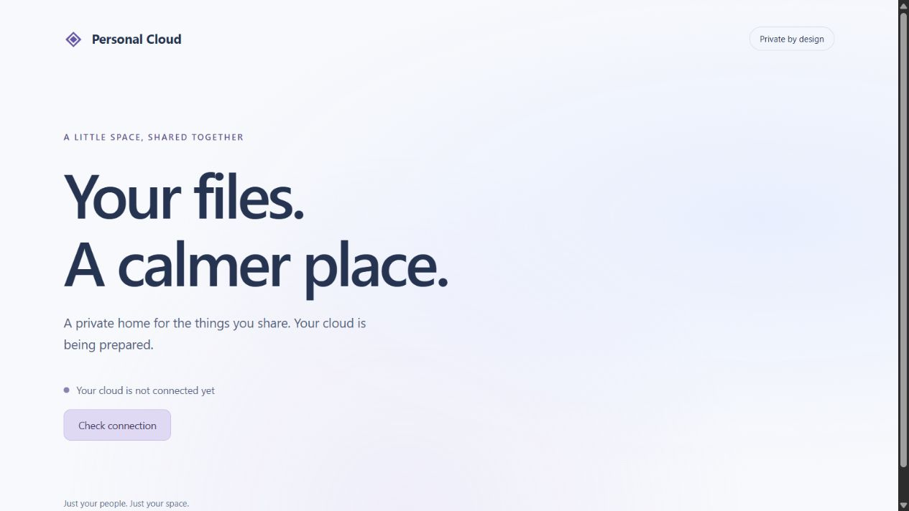
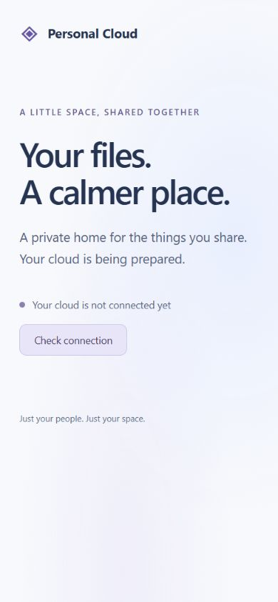

# Stage 2 execution evidence — 2026-10-20

Status updated 2026-10-21: **Stage 2 complete locally** on `stage-2-foundation`. Windows prerequisite, Docker installation and all remaining Compose/browser gates passed; see [final acceptance](stage-2-compose-verification.md). This document retains earlier native/source evidence and resolved failures. No cloud resources, production deployment, merge or later-stage business features performed.

## Changes and scope

- React/TypeScript/Vite welcome shell with real readiness client, bounded wait and retry; desktop/mobile layout. No pretend login or upload controls.
- FastAPI liveness/readiness, typed secret configuration, private structured request logging/errors and development-only startup boundary.
- Versioned PostgreSQL metadata schema, separate migration/runtime roles, persistent development Compose volumes and non-root API/proxy configuration.
- Locked dependencies, format/lint/type checks, offline secret guard/pre-commit hook, safe configuration initializer and disposable migration/recovery harness.
- Architecture, API, threat-model, bootstrap, preview and integrity contracts for later approved features.

## Executed evidence

Environment: Windows 11 Home, firmware virtualization enabled; Node 24.19.0, Python 3.12.14, pnpm 11.25.0, native PostgreSQL 17.11. All database rehearsal targets were newly generated loopback-only disposable clusters.

| Command/check | Observed result |
| --- | --- |
| `pnpm build` | Passed strict TypeScript and Vite production build; JS 221.28 kB / 69.30 kB gzip, CSS 1.65 kB. |
| `pnpm lint`, `pnpm format:check` | Passed ESLint and explicit Prettier enumeration of 14 source/configuration files. |
| `pnpm test` | 2 tests passed, 0 skipped: readiness response validation and network/malformed-response failure behavior. |
| Desktop/mobile browser smoke | Welcome shell, truthful unavailable state and retry inspected at 1280px and 390px widths; no horizontal overflow observed. Screenshots below. |
| `python -m ruff check backend scripts`, `ruff format --check backend scripts` | Passed; 12 Python files formatted. |
| `python scripts/verify_postgres.py --bin-dir .cache/postgres-runtime/pgsql/bin` | Passed empty/repeated Alembic upgrade, runtime-role denial of DDL, size constraint/transaction rollback, real ready endpoint and app/file marker persistence. Final full pytest: **7 passed**, no skips, before and after recovery, including actual request-log privacy checks. |
| Same disposable rehearsal | Committed metadata survived PostgreSQL process restart. Real `pg_dump`, downgrade to base, re-upgrade and `pg_restore` recovered the marker and readiness. Cluster stopped successfully. Final raw diagnostics retained only under ignored `.local/verification/31c039973543`; earlier passing six-test run was `ac4b87f77185`. |
| `uv lock --check --offline`, installed-version comparison | Lock resolved; all 65 installed locked distributions matched, no missing/mismatched versions. |
| `pip install --require-hashes -r requirements-dev.lock`, `pip check` | Locked requirements satisfied; no broken requirements. Sandbox cleanup warnings on temporary pip folders did not indicate application/test failure. |
| `pnpm audit`, `python -m pip_audit --local` | Final scans: 0 known vulnerabilities. This is a dated advisory result, not a security guarantee or container-image scan. |
| Secret scanner, `pre_commit install`, `pre_commit run --all-files` | Scanner passed across tracked/untracked non-ignored content; local Git hook installed and executed successfully. No staged additions existed, so hook success alone does not prove all new files were scanned; the separate full scan did cover them. |
| License inventory | Resolved frontend inventory and Python distribution license metadata reviewed locally; Python inventory contains 65 packages. psycopg binary notices and container licenses require redistribution review before production. |
| Local Markdown links and `git diff --check` | Passed. New untracked source files are covered by formatter/linter; Git whitespace check alone does not cover untracked files. |

## Observed failures and corrections

- Initial Ruff run found line wrapping, nested context managers and subprocess capture style. Applied formatter plus targeted equivalent syntax corrections; repeated lint/format passed.
- Initial default-sandbox pytest run failed to create its numbered temporary directories before two tests could execute. Repeated through the elevated local disposable harness using normal temporary-directory access: all six passed twice. No application fix was inferred from this environment failure.
- First PostgreSQL harness stalled despite server-ready log and exited `pg_ctl`: inherited subprocess output pipes prevented completion on Windows. Stopped only its disposable cluster, changed capture to private per-command files with a timeout, and repeated the complete same migration/restart/recovery sequence successfully.
- The environment initially supplied pip 25.0.1, while the lock requires 26.2.1. Audit flagged only old pip. Installed the exact locked pip; repeated version comparison, compatibility and audit checks passed.
- Prettier CLI directory/glob traversal skipped frontend files in this environment, while explicit source paths worked. Added explicit filesystem enumeration through Prettier's API and verified that 14 real files were checked. No unverified filesystem cause asserted.
- Two one-off verification shell commands had quoting/cache-path errors; corrected quoting and used a workspace uv cache, then repeated successfully. These errors did not alter application behavior.

## Acceptance status and remaining release criteria

Earlier Docker Desktop/WSL prerequisite failure was resolved on 2026-10-21 after owner completed installation/restart. Verified WSL 3.0.3.0/default 2, Docker Desktop installer exit 0, local Linux x86_64 Docker engine 29.8.2 and Compose v5.6.0. Official hello-world pull/run passed; exact PostgreSQL, Python, Node and Caddy image manifests advertise amd64/ARM64. Actual Compose application build/startup/recreation/named-volume/restore and browser gates then passed, as recorded in `stage-2-compose-verification.md`. ARM64 runtime/deployment acceptance remains a later release check.

Starlette TestClient emits an HTTPX deprecation warning; all seven tests pass. Review migration to the supported test transport when updating dependencies rather than adding a second HTTP client without need. Exact image manifests are now verified and the actual API Python inventory audit passes; OS-image advisories and production digest pinning remain release gates. An earlier native manifest request failed certificate validation and was not bypassed; Docker's verified registry requests succeeded on 2026-10-21.

Docker setup used official package metadata/source and resumable HTTPS downloads after winget Delivery Optimization stalled. Downloaded Docker Desktop 4.95.0 (242831); verified SHA-256 `73431db38491f770543880366228a23c993f84d1e8e045f56d83b8a98940cf76` and a Valid Authenticode signature before execution. Per-user installer returned **exit 1**. Its log explicitly states `Required Windows features are not enabled: VirtualMachinePlatform` and that per-user installation cannot enable the feature without administrator privileges. It recommends administrative `wsl --install`, restart and rerunning the installer. The verified installer remains ignored at `.cache/DockerDesktopInstaller.exe`.

Windows canceled the separate attempted elevation before the WSL setup script started. No successful elevated setup, feature enablement or automatic reboot occurred. Owner must complete the administrator prerequisite/restart; see `testing.md`. Do not automatically retry an elevation prompt that was canceled, switch to all-users installation or reboot the machine.

No public HTTPS, account login, file operations, daily OCI backup, full-size recovery, cloud billing or 24/7 acceptance is claimed. Those remain later-stage/release gates.

